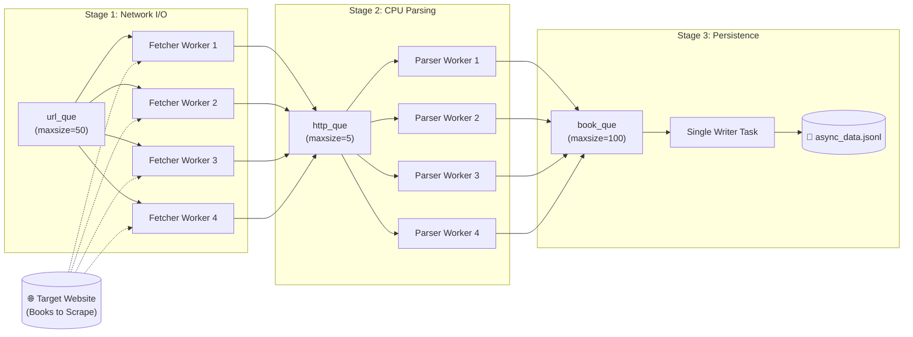

# ⚡ High-Throughput Async Web Scraper (3-Stage Pipeline)

[](https://www.python.org/downloads/)
[](https://docs.python.org/3/library/asyncio.html)
[](https://www.python-httpx.org/)
[](https://opensource.org/licenses/MIT)

A high-performance, fault-tolerant asynchronous web scraper built in Python using **`asyncio`**, **`httpx`**, and **`BeautifulSoup4`**. 

Unlike conventional scrapers that mix network requests, DOM parsing, and disk writes inside a single loop, this project implements a **3-stage decoupled assembly-line architecture** with bounded backpressure queues and a graceful cancellation cascade.

---

## 🏛️ System Architecture

The scraper decouples **Network I/O**, **CPU parsing**, and **Disk I/O** into distinct worker pools connected via asynchronous queues:



### Why this design?
* **Zero Waiting:** Fetchers don't pause to parse HTML; they immediately deposit responses into `http_que` and grab the next URL.
* **Controlled Concurrency:** 4 fetchers prevent triggering website rate limits or DDoS protections, while parsers chew through responses in parallel.
* **Backpressure Management:** Bounded queues (`maxsize`) prevent memory bloat. If parsers fall behind, fetchers automatically yield control to let parsers catch up.
* **Single-Writer Safety:** Disk writing is isolated in a dedicated task, avoiding file lock contention and ensuring atomic line-by-line JSON stream writing.

---

## 🚀 Key Features

* **3-Stage Decoupled Pipeline:** Independent worker pools for HTTP fetching, BeautifulSoup DOM parsing, and JSONL disk persistence.
* **Exponential Backoff & Jitter:** Automatically handles `429 Too Many Requests`, `5xx Server Errors`, and transient network drops with exponential delays ($1\text{s}, 2\text{s}, 4\text{s}, 8\text{s}, 16\text{s}$).
* **Client Error Handling:** Gracefully handles `400`, `401`, `403`, `404`, and `408` errors without killing the worker pool.
* **Deterministic Shutdown Cascade:** Coordinates graceful shutdown using `queue.join()` and `task.cancel()` across stages with zero deadlocks.
* **Structured Data Modeling:** Strongly typed `@dataclass` representation for scraped items with automated data sanitation, price extraction, star rating mapping, and URL resolution.
* **JSON Lines Output (`.jsonl`):** Streamed newline-delimited JSON format for optimal storage and streaming processing.

---

## 📊 Benchmark

Tested against 50 pages (1,000 book records) on [Books to Scrape](https://books.toscrape.com):

| Metric | Result |
| :--- | :--- |
| **Total Pages Scraped** | 50 / 50 |
| **Total Books Parsed** | 1,000 |
| **Failed Pages** | 0 |
| **Total Elapsed Time** | **~6.5s – 8.0s** |
| **Throughput** | **~125–150 books/second** |

---

## 🛠️ Installation & Setup

### 1. Clone the repository
```bash
git clone https://github.com/johnseife2602-source/concurrent-web-scraper.git
cd concurrent-web-scraper
```

### 2. Create and activate a virtual environment
```bash
# Windows (PowerShell)
python -m venv venv
.\venv\Scripts\Activate.ps1

# Linux / macOS
python3 -m venv venv
source venv/bin/activate
```

### 3. Install dependencies
```bash
pip install -r requirements.txt
```

### 4. Run the scraper
```bash
python concurrent_scraper.py
```

Scraped data will automatically be saved to `data/async_data.jsonl`.

---

## 📁 Project Structure

```text
Concurrent Web Scraper/
├── data/
│   └── async_data.jsonl          # Scraped book records in JSONL format
├── concurrent_scraper.py         # Main asynchronous scraping pipeline
├── requirements.txt              # Project dependencies
├── .gitignore                    # Git ignore file
└── README.md                     # Project documentation
```

---

## 📦 Data Schema Example

Each entry in `data/async_data.jsonl` follows this JSON structure:

```json
{
  "title": "A Light in the Attic",
  "price": 51.77,
  "rating": 3,
  "link": "https://books.toscrape.com/catalogue/a-light-in-the-attic_1000/index.html",
  "availability": true
}
```

---

## 🧠 Lessons Learned

1. **Task Scheduling in `asyncio`:** `asyncio.Queue.put()` only yields control if the queue is full. Bounded queues (`maxsize`) are essential for cooperative task interleaving and backpressure.
2. **The Worker Pattern:** Keep workers alive using `while True:` and guard item processing with `try ... finally: queue.task_done()` to ensure every pulled item is accounted for.
3. **Shutdown Orchestration:** Cascading `queue.join()` followed by `task.cancel()` across stages allows clean termination of infinite worker loops without requiring manual poison pill counts.

---

## 📄 License

This project is licensed under the [MIT License](LICENSE).

## Author

**Yohans Seife**

- GitHub: [@johnseife2602-source](https://github.com/johnseife2602-source)

Project 3 of my learning roadmap toward AI engineering. Project 2:
[to-do-app](https://github.com/johnseife2602-source/todo-app-pyqt5).
